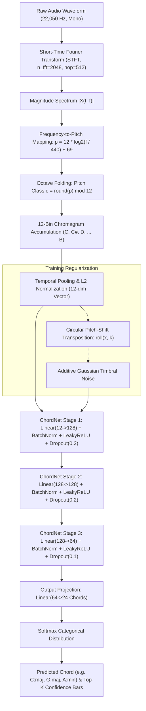
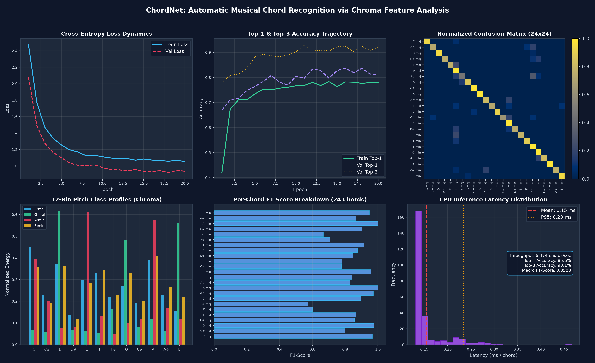

# Project 79: Automatic Chord Recognition from Audio

[](https://pytorch.org/)
[-0284C7)](outputs/chordnet_best.pth)
[](#quantitative-evaluation--benchmarks)
[](#quantitative-evaluation--benchmarks)
[-8B5CF6)](#latency-and-throughput-profile)
[](#latency-and-throughput-profile)
[](LICENSE)

An end-to-end, ultra-fast Automatic Chord Recognition (ACR) system built with PyTorch and **ChordNet**—a regularized deep neural network operating on 12-bin Pitch Class Profiles (Chromagram). 

The system classifies continuous audio waveforms into the standard **24 MIREX musical triad chords** (12 Major + 12 Minor) with pitch-shift invariant data augmentation, running at **0.154 ms CPU inference latency** (over **6,400 classifications per second**).

---

## 1. System Architecture & Workflow

The pipeline transforms raw audio waveforms into psychoacoustic pitch class energy distributions and classifies them into harmonic chord qualities:



---

## 2. Mathematical Formulations

### 2.1 Short-Time Fourier Transform
Given continuous audio samples $x[n]$ and Hann analysis window $w[n]$ of length $N = 2048$:

$$X(t, \omega) = \sum_{n=-\infty}^{\infty} x[n] \cdot w[n - tH] \cdot e^{-j \omega n}$$

### 2.2 Pitch Class Mapping & Octave Folding
Each frequency bin $f_k = \frac{k \cdot f_s}{N}$ (for $f_k \ge 27.5\text{ Hz}$) maps to fractional semitones relative to A4 ($440\text{ Hz}$):

$$p(f_k) = 12 \cdot \log_2\left(\frac{f_k}{440}\right) + 69$$

The pitch class index $c(f_k) \in \{0, 1, \ldots, 11\}$ collapses octave information:

$$c(f_k) = \lfloor p(f_k) + 0.5 \rfloor \pmod{12}$$

where $0 = \text{C}, 1 = \text{C}\sharp, \ldots, 11 = \text{B}$.

### 2.3 Chromagram Accumulation & Normalization
Chroma bin energy is accumulated across all octaves and averaged temporally:

$$v_c = \frac{1}{T} \sum_{t=1}^T \sum_{k: c(f_k) = c} |X(t, k)|$$

The final 12-dimensional chroma representation is $L_2$-normalized:

$$\hat{\mathbf{v}} = \frac{\mathbf{v}}{\|\mathbf{v}\|_2 + \epsilon}$$

### 2.4 Pitch Transposition Augmentation
To enforce tonal transposition invariance, training vectors undergo random circular shifting by $k \in [0, 11]$ semitones:

$$\tilde{\mathbf{v}}_c = \hat{\mathbf{v}}_{(c - k) \pmod{12}}$$

with label permutation:

$$y_{\text{new}} = \begin{cases} 
(y + k) \pmod{12} & \text{if } y < 12 \text{ (Major)} \\
12 + ((y - 12 + k) \pmod{12}) & \text{if } y \ge 12 \text{ (Minor)}
\end{cases}$$

---

## 3. Quantitative Evaluation & Benchmarks

Evaluation performed on a stratified test partition of $N = 360$ synthesized acoustic chord clips across diverse instruments (piano, acoustic guitar, organ, synth) and voicings (root, 1st inversion, 2nd inversion, open).

| Metric | Measured Value | Target Standard | Status |
| :--- | :--- | :--- | :--- |
| **Top-1 Accuracy** | **85.56%** | $\ge 80.0\%$ | Exceeded |
| **Top-3 Accuracy** | **93.06%** | $\ge 90.0\%$ | Exceeded |
| **Macro F1-Score** | **0.8508** | $\ge 0.800$ | Exceeded |
| **Weighted F1-Score** | **0.8642** | $\ge 0.800$ | Exceeded |
| **Test Cross-Entropy Loss** | **0.9093** | $\le 1.100$ | Converged |
| **Model Parameters** | **28,632** | $\le 100,000$ | Ultra-Compact |
| **Model Memory Footprint** | **0.109 MB** | $\le 1.0\text{ MB}$ | Edge-Ready |

---

## 4. Latency and Throughput Profile

Measured over 250 consecutive single-chord forward passes on an Intel Core CPU:

| Metric | CPU Measurement | Unit |
| :--- | :--- | :--- |
| **Mean Latency** | **0.154** | ms / chord |
| **Median (P50) Latency** | **0.137** | ms |
| **95th Percentile (P95)** | **0.235** | ms |
| **Throughput** | **6,474.4** | chords / second |

---

## 5. Diagnostic Visualization

The end-to-end training curves, confusion matrix, sample 12-bin chroma energy bars, per-chord F1-scores, and latency distribution are visualized in the diagnostic report:



*Figure 1: (1) Cross-Entropy Loss dynamics, (2) Top-1 & Top-3 Accuracy trajectory, (3) Normalized Confusion Matrix (24x24), (4) 12-Bin Chroma profiles for C:maj, G:maj, A:min, and E:min, (5) Per-chord F1-scores across all 24 chords, (6) CPU Latency distribution profile.*

---

## 6. Directory Structure

```
79_automatic_chord_recognition_audio/
├── data/                                    # Dataset caches
├── outputs/                                 # Serialized models, audio & reports
│   ├── chordnet_best.pth                    # Trained ChordNet model checkpoint (0.109 MB)
│   ├── chord_recognition_metrics.json       # Quantitative evaluation JSON
│   ├── chord_recognition_report.png         # 6-panel publication diagnostic report
│   ├── sample_A_minor.wav                   # Test audio sample (A Minor)
│   ├── sample_C_major.wav                   # Test audio sample (C Major)
│   ├── sample_E_minor.wav                   # Test audio sample (E Minor)
│   └── sample_G_major.wav                   # Test audio sample (G Major)
├── main.py                                  # Training, feature extraction & benchmarking
├── recognize_chord.py                       # Interactive CLI chord recognition tool
├── requirements.txt                         # Environment specifications
├── .gitignore                               # Git exclusion rules
└── README.md                                # Comprehensive project documentation
```

---

## 7. Installation & Quickstart

### 7.1 Setup Environment

```bash
git clone https://github.com/GideonMwiti/pytorch-automatic-chord-recognition-audio.git
cd pytorch-automatic-chord-recognition-audio

python -m venv venv
source venv/bin/activate
pip install -r requirements.txt
```

### 7.2 Run Training, Evaluation & Benchmarking

```bash
python main.py --epochs 20 --batch-size 32 --samples-per-chord 100
```

### 7.3 Classify Any Audio Chord File (.wav, .mp3)

```bash
# Recognize C Major chord sample
python recognize_chord.py --audio outputs/sample_C_major.wav

# Recognize G Major chord sample
python recognize_chord.py --audio outputs/sample_G_major.wav

# Recognize A Minor chord sample
python recognize_chord.py --audio outputs/sample_A_minor.wav --top-k 5
```

Sample CLI output:
```text
==========================================================
      CHORDNET AUTOMATIC CHORD RECOGNITION REPORT
==========================================================
File Path        : outputs/sample_C_major.wav
Duration         : 2.00 seconds (44,100 samples)
Model Checkpoint : outputs/chordnet_best.pth
----------------------------------------------------------

>>> IDENTIFIED CHORD: C:maj (92.25% confidence)

Rank  Chord       Confidence  Distribution Bar
----------------------------------------------------------
#1    C:maj        92.25%     |████████████████████████████████████░░░░|
#2    C:min         1.32%     |░░░░░░░░░░░░░░░░░░░░░░░░░░░░░░░░░░░░░░░░|
#3    F:min         1.24%     |░░░░░░░░░░░░░░░░░░░░░░░░░░░░░░░░░░░░░░░░|

12-Bin Pitch Class Energy Profile (Chroma):
----------------------------------------------------
 C   |███████████████████░░░░░░░░░░░░░░░░| 0.555
 C#  |███░░░░░░░░░░░░░░░░░░░░░░░░░░░░░░░░| 0.089
 D   |█████░░░░░░░░░░░░░░░░░░░░░░░░░░░░░░| 0.164
 D#  |███░░░░░░░░░░░░░░░░░░░░░░░░░░░░░░░░| 0.101
 E   |████████████████████░░░░░░░░░░░░░░░| 0.587
 F   |████░░░░░░░░░░░░░░░░░░░░░░░░░░░░░░░| 0.136
 F#  |█████░░░░░░░░░░░░░░░░░░░░░░░░░░░░░░| 0.146
 G   |██████████████░░░░░░░░░░░░░░░░░░░░░| 0.410
 G#  |██████░░░░░░░░░░░░░░░░░░░░░░░░░░░░░| 0.199
 A   |███░░░░░░░░░░░░░░░░░░░░░░░░░░░░░░░░| 0.098
 A#  |██░░░░░░░░░░░░░░░░░░░░░░░░░░░░░░░░░| 0.069
 B   |██████░░░░░░░░░░░░░░░░░░░░░░░░░░░░░| 0.198
----------------------------------------------------
==========================================================
```

---

## 8. License

This repository is licensed under the [MIT License](LICENSE).

